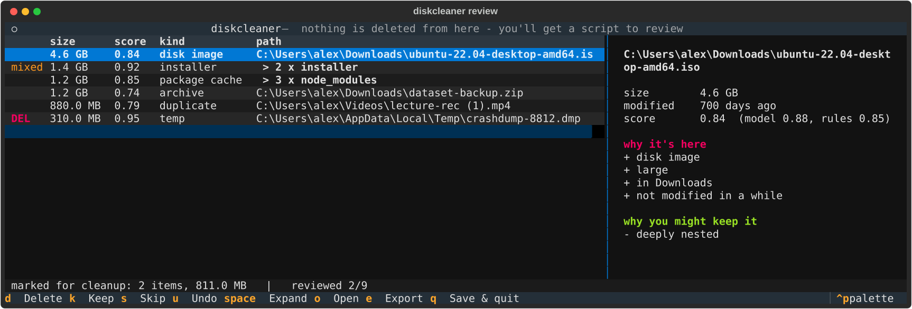

# diskcleaner

[](https://github.com/maddoxrjohnson/diskCleaner/actions/workflows/ci.yml)

A small CLI that finds big files and folders you probably don't need anymore,
explains why it thinks so, and learns from what you keep and what you toss.

It **never deletes anything itself.** You go through its suggestions, and at the
end it writes a cleanup script that you read and run yourself. That script sends
things to the Recycle Bin / Trash, so you can still get them back.



## Why

My laptop kept running out of space, and the usual culprits were the boring
ones: installers in Downloads from two years ago, `node_modules` folders for
projects I'd forgotten about, a 4 GB Ubuntu ISO. Existing disk analyzers show
you *what's big*, but not *what's safe to get rid of*. I also didn't want
anything deleting files on its own.

So the goals were:

1. **Conservative by default.** If it isn't sure, it says nothing.
2. **Explain every suggestion.** No black box. Each item says why it's on the list.
3. **Get better with use.** It starts with hand-written rules, and as you label
   things a small model learns your habits (e.g. "never suggest things under
   `projects/`", "old installers are always fine to remove").

## Install

Requires Python 3.10+.

```bash
git clone https://github.com/maddoxrjohnson/diskCleaner.git
cd diskCleaner
pip install -e .
```

## Usage

```bash
diskcleaner scan                 # scans your home folder
diskcleaner scan ~/Downloads     # or a specific folder
diskcleaner review               # go through suggestions interactively
diskcleaner export               # write the cleanup script
diskcleaner stats                # what you've labeled, what the last scan found
diskcleaner train                # retrain the model by hand (review does this for you)
diskcleaner forget               # wipe all saved scans, labels and the model
```

In `review`:

| key     | action                                         |
|---------|------------------------------------------------|
| `d`     | mark for cleanup                               |
| `k`     | keep (and teach the model you want this)       |
| `s`     | skip, no opinion                               |
| `u`     | undo the label                                 |
| `space` | expand a group (e.g. "14 x node_modules")      |
| `o`     | show it in Explorer / Finder                   |
| `c`     | copy the path (or all paths in a group)        |
| `e`     | export the cleanup script                      |
| `q`     | save and quit                                  |

Similar items are grouped, so you can label all 14 `node_modules` folders with
one keypress. Everything is sorted by **size x confidence**, so the first few
rows are usually most of the space you'll get back.

If you're on WSL scanning `/mnt/c/...`, `diskcleaner export --format ps1`
converts the paths so you can run the script from Windows PowerShell.

## How it works

```
scan -> safety rules -> heuristics -> model -> review (you) -> labels
                                        ^                        |
                                        +------- retrain --------+
```

**Scanning** (`scanner.py`) is an iterative `os.scandir` walk that never follows
symlinks or Windows junctions. Folders that are almost always regenerable
(`node_modules`, `.venv`, `target`, `__pycache__`, ...) are sized as one unit
and not descended into, which keeps scans quick. Generic names like `build`,
`dist` or `target` only count when there's a project file next to them
(`package.json`, `pom.xml`, `pubspec.yaml`, `Cargo.toml`, a `.csproj`, ...), and
`venv`/`env` only count if they're real virtualenvs. Eclipse, for example,
keeps plugin jars in a folder named `target`, and that is not build output. On my machine it gets through
about 370k files in around 20 seconds.

**Safety rules** (`safety.py`) are plain hard-coded checks that run before
anything else, and nothing downstream can override them:

- system folders (`C:\Windows`, `Program Files`, `Windows.old`, OEM recovery/driver folders, `/usr`, `/System`, ...) are never scanned
- files sitting directly in a drive root (`pagefile.sys`, `hiberfil.sys`, ...) are never suggested
- `.git`, `.ssh`, credential folders and cloud-synced folders (OneDrive, Dropbox, iCloud) are never suggested
- game libraries (`steamapps`, Epic, GOG, Xbox, ...) are never suggested, since those should be uninstalled through their launcher
- anything modified in the last 30 days is left alone
- app data (`AppData`, `~/.config`, `~/Library`) is only suggested if it's inside a cache/temp/log folder
- personal folders (Documents, Pictures, Videos, ...) only show up if the file is an exact duplicate

**Heuristics** (`rules.py`) put each item in a category (installer, build
artifact, package cache, duplicate, disk image, ...) and give it a starting
probability of being junk. Before you've labeled anything, this is the whole
ranking. One example of where this gets fiddly: a `.exe` only counts as an
installer if it looks like one (sitting loose in Downloads/Desktop, or with
"setup", a version number or an architecture in its name). An `.exe` sitting next to
DLLs is an installed program and gets left alone. The first version just
flagged every `.exe`, which happily suggested deleting my games.

**Duplicates** (`dupes.py`) are found the usual cheap way: group by size, then a
hash of the first and last 64 KB, then a full BLAKE2 hash only for files that
still match. The oldest copy is always treated as the original and never
suggested.

**The model** (`model.py`, `features.py`) is a scikit-learn logistic regression
over about 300 features: log size, days since modified/accessed, file count,
category and file type one-hots, location flags (Downloads, temp, ...), and the
folder names in the path hashed into 256 buckets. The path tokens are what let
it pick up rules like "I always keep stuff under `projects/`".

A few choices I made on purpose:

- **Logistic regression over something fancier.** There will only ever be a few
  hundred labels, and LR's coefficients turn directly into the "why it's here /
  why you might keep it" panel. Being able to explain a suggestion matters more
  here than a couple points of accuracy.
- **Cold start.** The model doesn't kick in until there are 20 labels with at
  least one of each kind. Until then it's rules only.
- **Blending.** The final score is a weighted mix of the model and the rules.
  The model's weight grows with the number of labels (`n / (n + 60)`) but never
  reaches 100%, so the rules keep acting as a sanity check.
- **Asymmetric cost.** Suggesting something you wanted to keep is worse than
  missing some junk, so "keep" labels are weighted 2x in training, and only items
  scoring 0.7 or higher are shown. `train` reports cross-validated **precision**
  on "delete" because that's the number that matters.
- **Access time mostly ignored.** On Windows, Defender and search indexing bump
  file access times constantly. Every installer in my Downloads looked "used
  4 days ago" even though it hadn't been touched in two years. The heuristics use
  modification time. Access time is still a model feature, so if it does mean
  something on your machine, the model can learn that.

**The cleanup script** (`export.py`) is the only thing that can remove files,
and you're the one who runs it. Before each item it checks that the file still
exists and hasn't changed since the scan, otherwise it skips it. It moves things
to the Recycle Bin / Trash (`gio trash`, `trash-put`, or Finder on macOS), and if
it can't find a trash command it refuses rather than falling back to `rm`.

Scans, labels and the model are stored in SQLite / joblib files in your OS's
user data folder, never in the repo or next to your files.

## Development

```bash
pip install -e ".[dev]"
pytest
ruff check .
```

The tests build fake directory trees in a temp folder (sparse files, so they
don't use real disk space) and cover the scanner, the safety rules, duplicate
detection, a synthetic "user" the model has to learn, quoting in the generated
scripts (paths like `it's a "weird" $(name).zip`), the review screen, and a real
run of the generated bash script against a fake trash command. CI runs everything
on Linux, macOS and Windows.

## Ideas for later

- an opt-in mode that sends approved items straight to the trash from the review screen
- smarter "is this project dead?" detection for build folders (last git commit date)
- incremental rescans instead of walking everything again

## License

MIT
